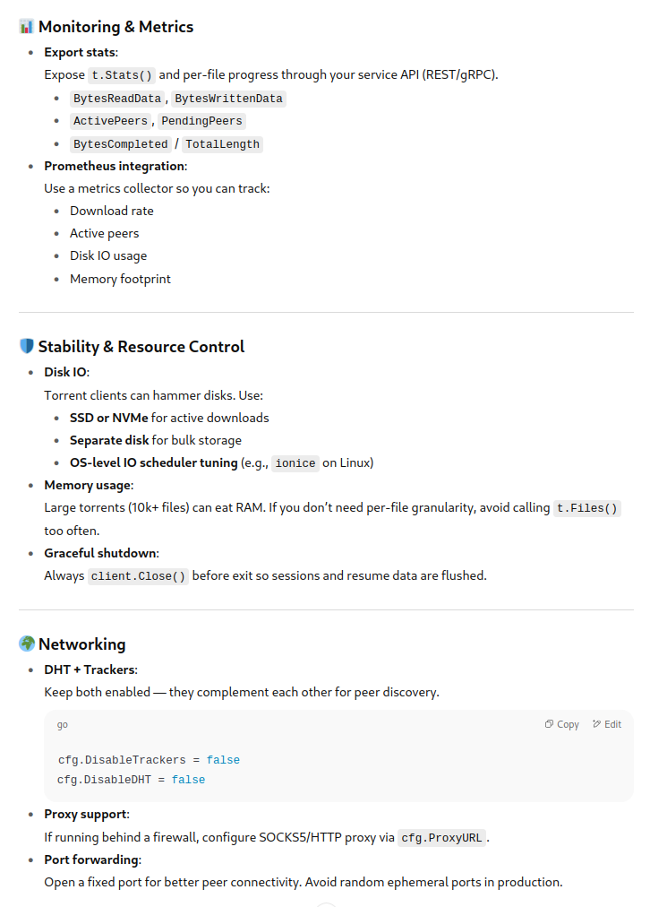
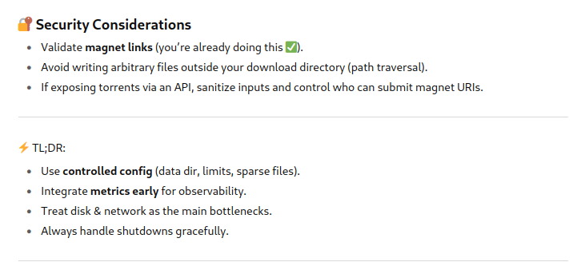

#### Validate magnet link
```golang
import (
	"fmt"
	"github.com/anacrolix/torrent/magnet"
)

func main() {
	uri := "magnet:?xt=urn:btih:0123456789abcdef0123456789abcdef01234567&dn=Example"

	m, err := magnet.ParseMagnetURI(uri)
	if err != nil {
		panic(err)
	}

	fmt.Println("DisplayName:", m.DisplayName)
	fmt.Println("Trackers:", m.Trackers)
	fmt.Println("InfoHashes:", m.InfoHashes) // supports v1 & v2
}
```

#### Minimal torrent client
```golang
package main

import (
	"flag"
	"fmt"
	"log"

	"github.com/anacrolix/torrent"
	"github.com/anacrolix/torrent/magnet"
)

func main() {
	magnetURI := flag.String("magnet", "", "Magnet URI to fetch metadata for")
	flag.Parse()

	if *magnetURI == "" {
		log.Fatal("please provide a magnet link with -magnet")
	}

	// Parse the magnet
	m, err := magnet.ParseMagnetURI(*magnetURI)
	if err != nil {
		log.Fatalf("invalid magnet: %v", err)
	}

	// Configure torrent client
	cfg := torrent.NewDefaultClientConfig()
	cfg.DataDir = "./downloads" // where files would be saved if downloaded

	client, err := torrent.NewClient(cfg)
	if err != nil {
		log.Fatalf("failed to create torrent client: %v", err)
	}
	defer client.Close()

	// Add magnet to client
	t, err := client.AddMagnet(*magnetURI)
	if err != nil {
		log.Fatalf("failed to add magnet: %v", err)
	}

	fmt.Println("Fetching metadata...")
	<-t.GotInfo() // wait until metadata is fetched

	// Save metadata for future reuse
	t.DownloadAll() // start downloading files (optional)

	info := t.Info()
	fmt.Printf("Torrent name: %s\n", info.Name)
	fmt.Println("Files:")

	for _, f := range info.Files {
		fmt.Printf(" - %s (%d bytes)\n", f.Path(), f.Length)
	}
}
```

#### tiny torrent downloader with progress bar
```golang
package main

import (
	"flag"
	"fmt"
	"log"
	"time"

	"github.com/anacrolix/torrent"
	"github.com/anacrolix/torrent/magnet"
)

func main() {
	magnetURI := flag.String("magnet", "", "Magnet URI to download")
	flag.Parse()

	if *magnetURI == "" {
		log.Fatal("please provide a magnet link with -magnet")
	}

	// Parse the magnet link
	m, err := magnet.ParseMagnetURI(*magnetURI)
	if err != nil {
		log.Fatalf("invalid magnet: %v", err)
	}

	// Configure client
	cfg := torrent.NewDefaultClientConfig()
	cfg.DataDir = "./downloads" // files saved here
	client, err := torrent.NewClient(cfg)
	if err != nil {
		log.Fatalf("failed to create torrent client: %v", err)
	}
	defer client.Close()

	// Add torrent from magnet
	t, err := client.AddMagnet(*magnetURI)
	if err != nil {
		log.Fatalf("failed to add magnet: %v", err)
	}

	fmt.Println("Fetching metadata...")
	<-t.GotInfo()
	t.DownloadAll() // start downloading everything

	info := t.Info()
	fmt.Printf("Torrent name: %s\n", info.Name)
	fmt.Println("Files:")
	for _, f := range info.Files {
		fmt.Printf(" - %s (%d bytes)\n", f.Path(), f.Length)
	}

	// Progress loop
	fmt.Println("\nDownloading...")
	for {
		// Completed fraction (0.0–1.0)
		progress := t.BytesCompleted()
		total := t.Info().TotalLength()
		percent := float64(progress) / float64(total) * 100

		fmt.Printf("\rProgress: %.2f%% | Peers: %d | Downloaded: %d / %d bytes",
			percent, t.Stats().ActivePeers, progress, total)

		if progress >= total {
			fmt.Println("\nDownload complete ✅")
			break
		}

		time.Sleep(2 * time.Second)
	}
}
```

#### Client Configuration
```golang
// Data directory:
cfg := torrent.NewDefaultClientConfig()
cfg.DataDir = "/var/lib/myservice/torrents"

// If you only need metadata or don’t want to re-upload data, disable seeding:
cfg.Seed = false

// Useful if you don’t want your service to become an unintended seeder
cfg.UploadRateLimiter = rate.NewLimiter(rate.Limit(50*1024), 50*1024) // 50 KB/s

// Control memory & CPU usage by setting peer connection caps:
cfg.MaxActiveDownloads = 5
cfg.MaxHalfOpenConnections = 50

// Enable sparse files so the client doesn’t preallocate the entire disk size up front. Saves time & space.
cfg.NoUpload = true
cfg.DisableAggressiveUpload = true

// You can download specific files instead of the entire torrent:
f := t.Files()[0]
f.Download()
```

